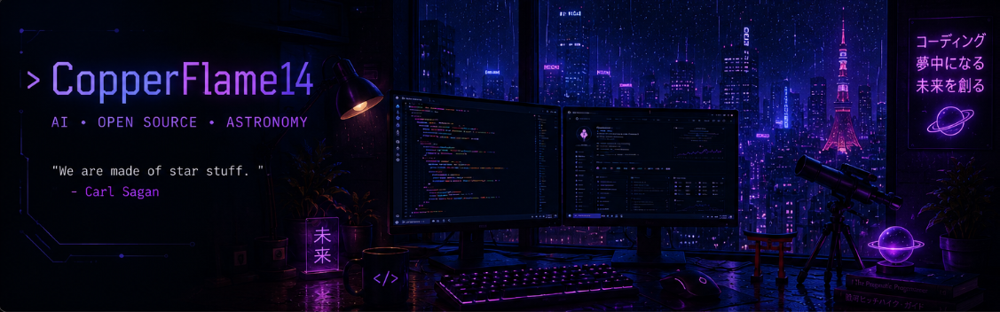

 <div align="center">



<br/>

<div align="center">

<a href="https://git.io/typing-svg">
  
</a>

</div>

<br/>

[](https://github.com/CopperFlame14)
[](https://www.linkedin.com/in/m-r-krishni-084586320/)
[](https://leetcode.com/u/krishni_/)
[](https://www.hackerrank.com/profile/krishnimr14)

<div align="center">

<a href="https://hits.sh/github.com/CopperFlame14/CopperFlame14/">
  
</a>

</div>

</div>

---

<div align="left">

## `$ ssh github.com/CopperFlame14`

```text
Authenticating...

████████████████████████████ 100%

[ OK ] Identity verified
[ OK ] Secure connection established
[ OK ] Developer environment loaded

Welcome back, Krishni.
```


</div>

---

## `$ neofetch`

<div align="left">

```text
       /\          krishni@github
      /  \         ------------------------------
     /\   \        OS:             Windows 
    /      \       Host:           VIT Chennai
   /   ,,   \      Kernel:         Computer Science
  /   |  |   \     Shell:          Terminal
 /_-''    ''-_\    Editor:         VS Code

                    Languages:      Java, Python, C,
                                    C++, JavaScript, SQL

                    Focus:          AI / ML, Data Science
                                    Software Development

                    Open Source:    GSSoC 2026

                    Interests:      Astronomy, F1,
                                    Japanese, Photography

                    Status:         Always learning...
```

</div>

---

## `$ cat about.txt`

<div align="left">

```yaml
name: Krishni M R
education: B.Tech Computer Science Engineering
university: VIT Chennai

focus:
  - Artificial Intelligence
  - Machine Learning
  - Data Science
  - Software Engineering
  - Backend Development

currently_exploring:
  - Machine Learning applications
  - Full-stack development
  - Computer systems and networking
  - Open-source collaboration

interests:
  - Automotive technology and F1 telemetry
  - Astronomy and astrophotography
  - Space exploration
  - Japanese language and culture

philosophy: "Learn. Build. Break. Debug. Repeat."
```

</div>

---

## `$ ls ./tech-stack/`

<div align="center">

### Languages


### AI / ML & Data Science


### Web Development


### Databases & Cloud


### Tools & Environment


</div>

---

## `$ neofetch --stats`

<div align="center">


</div>

---

## `$ cd ~/projects && ls -la`

<div align="center">

<sub>Five projects. Different problem domains. One goal: building things that work.</sub>

</div>

### `01` — Smart Home Energy Forecasting & Waste Pattern Analysis

**Repository:** [`energypredictor_fds`](https://github.com/CopperFlame14/energypredictor_fds)

<div align="center">


</div>

An end-to-end machine learning project focused on understanding household energy consumption, forecasting future demand, and identifying potentially inefficient usage patterns using a dataset containing approximately 100,000 observations.

**Inside the pipeline:**

- **Exploratory Data Analysis:** Investigates household energy usage, temporal behaviour, environmental variables and feature relationships.
- **Feature Engineering:** Prepares temporal and environmental variables for model training and prediction.
- **Model Benchmarking:** Compares Linear Regression, Decision Tree, Random Forest, K-Nearest Neighbors and XGBoost.
- **Dimensionality Reduction:** Applies Principal Component Analysis (PCA) to explore feature structure.
- **Consumption Pattern Analysis:** Uses K-Means clustering to group usage patterns and investigate potential energy-waste behaviour.
- **Time-Series Forecasting:** Uses ARIMA to generate a 30-day energy consumption forecast.
- **Prediction Interface:** Integrates trained models into a Flask application with prediction functionality and forecast visualizations.

**Core focus:** Predictive modelling, time-series analysis and pattern discovery in a practical energy-monitoring application.

<div align="center">

[](https://github.com/CopperFlame14/energypredictor_fds)

</div>

---

### `02` — Classroom Availability Tracker

**Repository:** [`web_project_krishni`](https://github.com/CopperFlame14/web_project_krishni)

<div align="center">


</div>

A full-stack classroom discovery and reservation platform designed to make room availability easier to inspect and manage. The application brings classroom information, scheduling and reservation workflows together.

**System capabilities:**

- **Classroom Discovery:** Centralized interface for exploring classroom availability and room information.
- **Reservation Management:** Classroom reservation workflows with scheduling conflict checks.
- **Role-Based Workflows:** Dedicated student, professor and administrative functionality.
- **Timetable Integration:** Scheduling information and availability-related operations.
- **Real-Time Communication:** WebSockets for live updates and notification workflows.
- **Backend Architecture:** Modular Express API routes for authentication, classrooms, reservations, timetables and other application features.
- **Database Layer:** Persistent storage for application and reservation data.

**Core focus:** Multi-role application design, scheduling logic, backend services, persistent data and real-time communication.

<div align="center">

[](https://github.com/CopperFlame14/web_project_krishni)

</div>

---

### `03` — SmartCare: Hospital Administrative Analytics Dashboard

**Repository:** [`bck_smartcare_analytics`](https://github.com/CopperFlame14/bck_smartcare_analytics)

<div align="center">


</div>

A hospital administration dashboard focused on turning operational information into a more accessible view of hospital activity, resource utilization and service efficiency.

**What it brings together:**

- **Authentication & Access:** Firebase Authentication with role-based administrative access.
- **Operational Overview:** Dashboard metrics for patient counts, average waiting times, bed availability and hospital efficiency.
- **Data Visualization:** Chart.js visualizations for operational patterns and performance indicators.
- **Live Data Synchronization:** Firebase Firestore integration for synchronizing dashboard data.
- **Capacity Monitoring:** Tracks waiting times and bed availability against configured thresholds.
- **Patient Load Estimation:** Uses historical capacity information and application-side estimation logic to explore next-day patient demand.

**Core focus:** Web development, cloud-backed data management and visual analytics for operational decision support.

<div align="center">

[](https://github.com/CopperFlame14/bck_smartcare_analytics)

</div>

---

### `04` — Two-Way Simple Chat Protocol (SCP)

**Repository:** [`simple_chat_v2`](https://github.com/CopperFlame14/simple_chat_v2)

<div align="center">


</div>

A computer-networks project exploring message exchange, protocol behaviour and bidirectional communication through an interactive protocol simulator and a live WebSocket implementation.

**Protocol exploration:**

- **Two-Way Communication:** Demonstrates communication initiated from both client and server sides.
- **Message Identification:** Uses message identifiers to associate messages with their corresponding acknowledgements.
- **Acknowledgement Handling:** Simulates ACK messages and tracks whether messages have been acknowledged.
- **Timeout & Retransmission:** Implements timeout handling and retry behaviour when acknowledgements are not received.
- **Packet Loss Simulation:** Simulates packet loss to observe how unreliable transmission affects communication.
- **Event Logging:** Displays message events, acknowledgements, timeouts and transmission failures.

**Live implementation:**

- Express server with WebSocket connections.
- Generates session codes for client connection.
- Supports a two-client session model.
- Relays messages between connected clients in both directions.
- Handles client disconnections and session resets.

**Core focus:** Communication protocols, acknowledgements, reliability, connection state and failure handling.

<div align="center">

[](https://github.com/CopperFlame14/simple_chat_v2)

</div>

---

### `05` — House Price Prediction

**Repository:** [`HousePricePrediction_MRKrishni`](https://github.com/CopperFlame14/HousePricePrediction_MRKrishni)

<div align="center">


</div>

A supervised machine learning project exploring how housing attributes influence property prices and evaluating different regression algorithms on a housing dataset.

**Modelling workflow:**

- **Data Preparation:** Examines missing values, removes duplicate records and prepares features for modelling.
- **Categorical Encoding:** Converts categorical variables into machine-readable representations, including one-hot encoding.
- **Model Development:** Trains and compares Linear Regression, Random Forest Regressor and XGBoost Regressor.
- **Performance Evaluation:** Uses Mean Absolute Error (MAE), Root Mean Squared Error (RMSE) and the coefficient of determination (R²).
- **Comparative Analysis:** Evaluates model performance to understand the trade-offs between different regression approaches.

**Observed model results in the project analysis:**

| Model | R² Score |
|:---|---:|
| Linear Regression | 0.653 |
| XGBoost | 0.642 |
| Random Forest | 0.612 |

**Core focus:** Applying the complete regression workflow — from data cleaning and feature preparation to model comparison and evaluation.

<div align="center">

[](https://github.com/CopperFlame14/HousePricePrediction_MRKrishni)

</div>

---

## `$ git log --author="Krishni" --merged`

I also contribute to collaborative open-source projects, working on features, algorithm visualizations, bug fixes and improvements.

| Repository | Contributions |
|:---|:---|
| **AlgoScope** | Stack behaviour, Tower of Hanoi, Prim's and Kruskal's algorithm visualizations |
| **AlgoMate** | Heap Sort, Floyd-Warshall, Counting Sort and stack capacity improvements |
| **peer-learning** | Portfolio functionality, Google OAuth and onboarding improvements |
| **recode-website** | Accessibility improvements and blog author-section styling |
| **devtrack** | Heatmap colour-scale improvements |
| **sahidawa-india** | Snooze tracker functionality and application improvements |
| **100_days_100_web_project** | Sudoku and Dining Philosophers project fixes |

<div align="center">

<sub>Collaborating, contributing and learning from the open-source community.</sub>

</div>

---

## `$ cat interests.txt`

<div align="left">

```text
┌─────────────────────────────────────────────────────┐
│                  BEYOND THE TERMINAL                │
├─────────────────────────────────────────────────────┤
│                                                     │
│  [01] SPACE                                         │
│       Astronomy, astrophotography and exploration   │
│                                                     │
│  [02] AUTOMOTIVE                                    │
│       Formula 1, telemetry and vehicle technology   │
│       Red Bull Racing | Max Verstappen              │
│                                                     │
│  [03] JAPANESE                                      │
│       Language learning and Japanese culture        │
│                                                     │
│  [04] PHOTOGRAPHY                                   │
│       Capturing stories through a camera            │
│       Instagram: framed.scene                       │
│                                                     │
│  [05] ANIME & MUSIC                                 │
│       One Piece, Attack on Titan, Haikyuu and more  │
│                                                     │
└─────────────────────────────────────────────────────┘
```

</div>

---

## `$ ./current-mission.sh`

<div align="center">

| Mission | Status |
|:---|:---:|
| AI & Machine Learning | `IN PROGRESS` |
| Data Structures & Algorithms | `IN PROGRESS` |
| Open-Source Contributions | `ACTIVE` |
| Software Engineering | `IN PROGRESS` |
| Japanese Language | `LEARNING` |
| Astronomy & Astrophotography | `EXPLORING` |

</div>

---


## `$ github --contributions`

<div align="center">


</div>

---

## `$ github --metrics`

<div align="center">


</div>

---

## `$ ping krishni`

<div align="center">

[](https://github.com/CopperFlame14)
[](https://www.linkedin.com/in/m-r-krishni-084586320/)
[](https://leetcode.com/u/krishni_/)
[](https://www.hackerrank.com/profile/krishnimr14)

<br/>

<pre align="left">
┌──(krishni㉿github)-[~]
└─$ echo "Thanks for stopping by!"
Thanks for stopping by!

┌──(krishni㉿github)-[~]
└─$ _
</pre>

<br/>


**"The best code is written when the world is asleep."** 🌙

</div>
